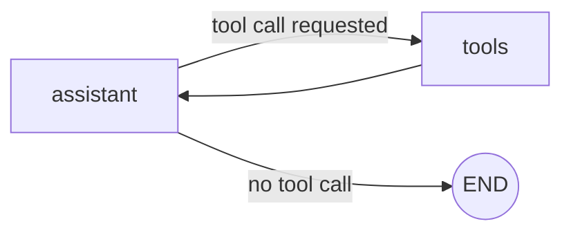
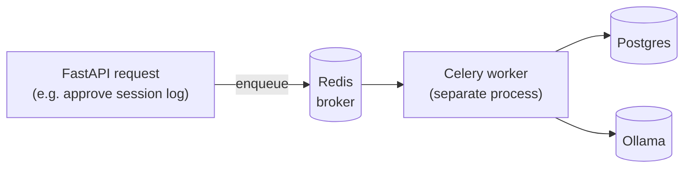
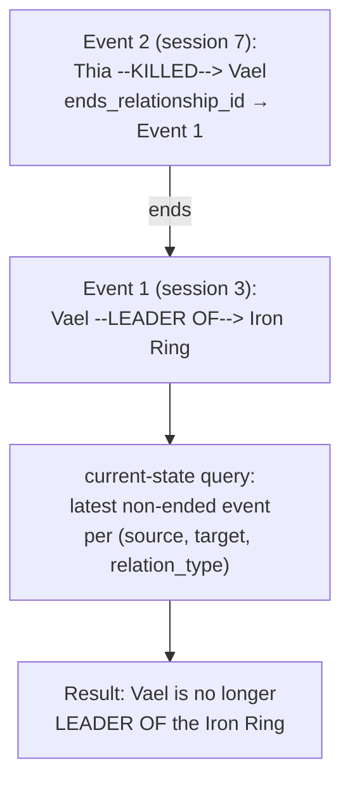
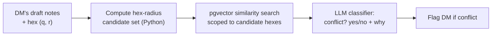

# Architecture

## Layout

```text
app/
├── agent/     # LangGraph state graph, nodes, tools, schemas — zero FastAPI deps
├── api/       # FastAPI routers, dependency injection, middleware
├── db/        # Async SQLAlchemy/asyncpg connections, DDL bootstrap
├── schemas/   # Pydantic v2 request/response and LLM structured-output models
└── main.py    # FastAPI entry point + lifespan wiring
```

The `agent` package has no import dependency on `fastapi`; the graph it
builds is plain LangGraph and can be tested or driven from a CLI without the
API layer running.

## Graph topology



`assistant` calls the local Ollama model (`llama3.1:8b` by default) with the
running message history. If the model requests a tool call, `tools_condition`
routes to the `tools` node (a `ToolNode` wrapping `lookup_lore` and future
world-state tools); otherwise the turn ends.

## State

`CampaignState` (`app/agent/state.py`) is a `TypedDict` with:

- `messages: Annotated[list, add_messages]` — reducer-based history so
  parallel node writes append instead of clobbering each other.
- `session_id: str` — scopes world-state lookups and RAG retrieval to one
  campaign session.

## Checkpointing

The graph is compiled once, at FastAPI startup (`app/main.py` `lifespan`),
with an `AsyncSqliteSaver` opened for the app's full lifetime. Compiling —
and therefore opening the SQLite connection — per request would block the
event loop on every call; the shared checkpointer keeps everything
non-blocking. Each chat session is a distinct `thread_id` in the checkpoint
store.

## Database schema

Postgres + `pgvector`, async access via SQLAlchemy 2.0 (`asyncpg` driver).
Conventions:

- Primary keys: `UUID`, server-generated via `gen_random_uuid()`.
- Embedding columns: `vector(768)`, matching `nomic-embed-text` (or any other
  768-dim local embedding model run through Ollama).
- Flexible per-entity metadata (hex coordinates, level ranges, faction
  standing, etc.): `JSONB`.

`app/db/bootstrap.py` enables the `vector` extension and creates tables from
`app/db/models.py` directly (`Base.metadata.create_all`). This is sufficient
for the current two-table schema; see [Migrations](#migrations) below for
the plan to introduce Alembic before the schema grows further.

## RAG over campaign lore

Not yet implemented (see `app/agent/tools.py::lookup_lore`). Planned flow:
narration/session notes → chunk → embed via Ollama (`nomic-embed-text`) →
store in a dedicated `lore_chunks` table (see
[Hex-based conflict detection](#hex-based-conflict-detection) below) →
similarity search (`pgvector` cosine distance) from the `lookup_lore` tool.

## LLM provider abstraction

`app/agent/graph.py` currently calls `ollama.AsyncClient` directly. As more
features lean on the LLM for structured extraction (not just chat), this
becomes a liability — every call site would need its own JSON-parsing and
provider-specific error handling.

Planned change: adopt `langchain-ollama`'s `ChatOllama`, which implements
LangChain's standard `BaseChatModel` interface, behind a small factory:

```python
# app/agent/llm.py
def get_chat_model() -> BaseChatModel:
    """Return the configured chat model (env: LLM_PROVIDER, default "ollama")."""
```

Every LLM call in the codebase — chat, NER/relationship extraction, rumor
generation, conflict classification, log normalization — goes through
`model.with_structured_output(SomePydanticModel)`, reusing the pattern
already established by `app/schemas/campaign.py::ExtractedEntity`. Swapping
providers later (Anthropic, Bedrock, OpenAI) becomes a one-line change at
the factory, not a rewrite of every call site.

## Background jobs: Celery + Redis

Several planned features (rumor generation, entity/relationship extraction,
conflict detection) call an LLM from a workflow step that shouldn't block an
HTTP response — those calls can take anywhere from a few seconds to over a
minute. These run as asynchronous background jobs instead:



- **Redis** is only the broker/result-backend — it holds queued job
  messages, it doesn't run any application code.
- **Celery workers** run as a separate OS process (`app/worker/`), so they
  don't share the FastAPI/Uvicorn event loop. CLAUDE.md's "non-blocking
  DB calls" rule protects that event loop specifically — it doesn't apply
  inside a worker process, so worker task bodies use a plain **synchronous**
  SQLAlchemy session rather than `asyncio.run()` gymnastics. This
  async-web-tier / sync-worker-tier split is itself a common production
  pattern.
- FastAPI routes enqueue with `task.delay(...)` and return immediately;
  they only depend on the task's signature, not its implementation.

## Entity relationship graph (event-sourced)

Standard vector search finds a sentence about a past event well, but it
doesn't track how entities relate to each other *over time*. Naively storing
a relationship as a single mutable row breaks as soon as the world changes
(e.g. an NPC dies and should no longer be "LEADER OF" their faction).

Instead, relationships are modeled as an **append-only event log** —
`relationship_events` (`source_entity_id`, `target_entity_id`,
`relation_type`, `description`, `session_log_id`, `occurred_at`,
`ends_relationship_id` nullable FK to a prior event it retires):



"Current state" (e.g. "what are the political relationships in Shadowbrook
right now?") is always a *query* over this log — never a separately
maintained table — because it's the only way to answer both "what's true
now" and "what was true as of session 5" from the same data. Extraction
prompts must be able to emit both "asserts" and "ends" events, not just
assertions.

This stays in Postgres rather than a dedicated graph database (Neo4j,
Apache AGE, Kùzu): campaign scale is small enough that recursive CTEs
handle multi-hop traversal fine, Apache AGE isn't supported on AWS
RDS/Aurora (relevant since AWS is the eventual deployment target), and
Kùzu's embedded-per-process model doesn't map cleanly to a future
multi-instance deployment. A dedicated embedded graph engine (Kùzu) remains
a documented upgrade path if path-finding queries ever get too painful in
SQL — not needed for the initial build.

## Hex-based conflict detection

Multiple DMs sharing one hex map can accidentally contradict each other's
lore. Before a DM runs a new session, their notes get checked against
nearby history:



- No PostGIS — it's a real geospatial engine, overkill for a hand-authored
  hex grid. Hex coordinates are plain integer columns (`hex_q`, `hex_r`,
  axial coordinates) on `session_logs`, `entities`, and `lore_chunks`.
- The radius search itself (e.g. "within 2 hexes") is a handful of lines of
  cube-coordinate distance math in Python, producing a candidate set of
  `(q, r)` pairs used as a plain `WHERE (hex_q, hex_r) IN (...)` filter,
  combined with `pgvector` cosine-similarity ordering.
- The LLM's role is narrow and structured on purpose: a yes/no verdict plus
  a one-line explanation, not a rewritten story.

## Migrations

`Base.metadata.create_all` (current `app/db/bootstrap.py`) works for the
existing two-table schema, but every feature above adds new tables
(`session_logs`, `relationship_events`, `rumors`, `lore_chunks`). Alembic
gets introduced before any of those land, so every schema change afterward
is a reviewable, reversible migration instead of a widening `create_all`
call.

## Containerization and local deployment

Today, `docker-compose.yml` only runs *infrastructure* (Postgres, Ollama) —
the API itself runs via `poetry run uvicorn` on the host. To support running
the whole stack locally (not just its dependencies), the plan adds:

- A `Dockerfile` (multi-stage: Poetry install, slim Python 3.12 runtime).
- `redis`, `api`, and `worker` services in `docker-compose.yml` — `api` and
  `worker` build from the same image and point `DATABASE_URL` /
  `OLLAMA_HOST` / `CELERY_BROKER_URL` at the other services by name instead
  of `localhost`.

`poetry run uvicorn --reload` on the host stays the fast inner-loop dev
workflow; `docker-compose up` becomes the full local-deployment mode that
exercises the same containers a future AWS deployment would mirror.
