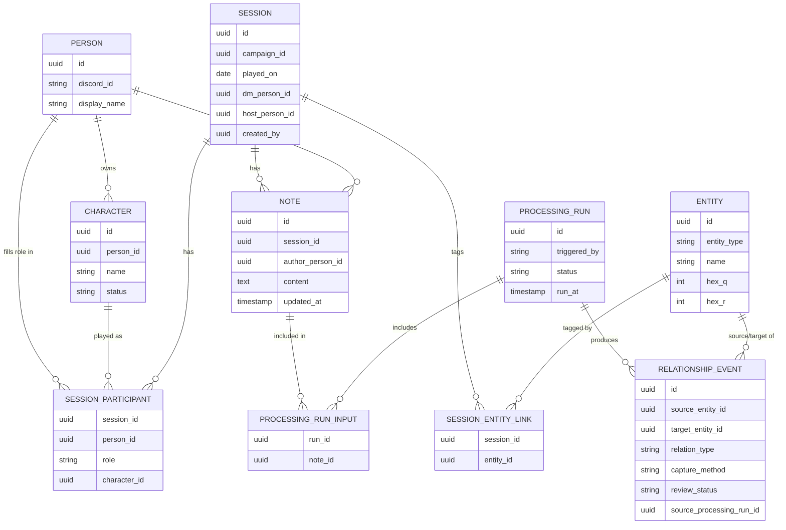

# Data Model

This page is the authoritative reference for the domain model — the actual
entities, their relationships, and the reasoning behind them. It exists
because a lot of the early feature ideas (see [Home](index.md)) leaned on
LLM inference to reconstruct structure (who was there, where it happened,
who's involved) that a human already knows at the moment they're entering
data. Pushing that structure earlier removes entire categories of
unreliable inference from the system. [Architecture](architecture.md)
covers the surrounding technical machinery (the agent graph, the task
queue, containerization); this page covers the shape of the data itself.

## Structure over inference

Two things turned out to be inference problems in disguise, not extraction
problems:

- **Spatial position.** A DM writing "near the Whispering Caves" gives an
  LLM nothing to reliably convert into a hex coordinate — there's no
  ground truth in the prose to extract, only a guess to make. If hex
  coordinates instead live on a `Location`-type `Entity` record the DM
  already maintains, and sessions just tag which entities they touched,
  the "infer spatial position from narrative" problem disappears entirely.
- **Identity resolution.** Deciding that "Vael," "Captain Vael," and "the
  captain" across three different notes are the same NPC is an open-ended
  fuzzy-matching problem — get it wrong and you get duplicate ghost-NPCs or
  merged-identity errors baked permanently into the relationship graph. If
  people instead select participants/entities from an existing registry (or
  quick-create a new one, which pins the canonical ID at creation time),
  identity resolution is solved at the moment of entry, for free.

The rule of thumb this produced: **anything a human at the table already
knows when they sit down to log a session should be captured as a direct
reference (a foreign key), not left for an LLM to reconstruct from prose
afterward.** Free text is reserved for what's genuinely narrative —
the qualitative account of what happened — not for facts a picker could
have captured directly.

## The three-tier capture model

Facts enter the system through three tiers, in decreasing order of trust
and increasing order of processing cost:

| Tier | Method | Example | Cost | Default review status |
|---|---|---|---|---|
| 0 | Structured form fields | Session participants, tagged locations/quests | None — direct reference | Auto-approved |
| 1 | Inline syntax in notes | `[[Captain Vael]]`, `#hex:Shadowbrook` | Deterministic parsing, no LLM call | Auto-approved |
| 2 | Free prose | Anything not tagged by syntax | LLM extraction | Always pending review |

Tier 1 is deliberately modeled on Obsidian's `[[wiki-link]]` convention —
familiar to DMs who already use it for world-building, and cheap because
it's a small deterministic grammar, not natural-language inference. It's a
secondary feature (see [Roadmap](roadmap.md)), not required for the system
to function; plain prose always falls back to tier 2.

## Core entities

`Session.dm_person_id`/`host_person_id`/`created_by` are direct references
to `Person` (not shown as separate diagram edges to avoid clutter) —
`SESSION_PARTICIPANT` is still the source of truth for "who's involved and
as what," but `Session` keeps its own DM/host pointers so they're cheap to
read and so the host-must-be-a-player rule (below) has something concrete
to validate against.

### Master data (mutable, no inference involved)

- **`Person`** — a real human. Created *only* as a side effect of a
  successful Discord login (see [Authentication](#authentication-and-entitlements))
  — there's no manual "add a player" form. `discord_id` is the link back
  to the OAuth identity.
- **`Character`** — a PC, owned by a `Person`. Deliberately no "one active
  character per person" constraint — a player can run multiple
  simultaneously-active PCs, and retired/dead ones stick around via
  `status` rather than being deleted. Which character a person is playing
  is decided per-session (on `SessionParticipant`), not globally.
- **`Entity`** — the single registry for NPCs, locations, factions, items,
  and quests (`entity_type` discriminates). Locations and quests aren't
  separate tables — a location is just an entity with `hex_q`/`hex_r`
  populated. This is also what unifies "tag the hex(es) touched" and "tag
  the quest/hook addressed" into one mechanism (see `SessionEntityLink`
  below) instead of two.

### Session & activity data (mutable, "living" records)

- **`Session`** — a scheduled or played game: campaign, date,
  `dm_person_id`, `host_person_id`, `created_by`. Rosters change
  constantly in a West Marches campaign — this and `SessionParticipant`
  are ordinary mutable records, edited in place as availability shifts,
  not an event log. That's a deliberate contrast with `RelationshipEvent`
  below: scheduling logistics only ever need "what's true right now,"
  while in-fiction world state needs a real timeline.
- **`SessionParticipant`** — one row per person per session, unique on
  `(session_id, person_id)`. `role` is `dm` or `player` — never both, and
  never a separate `host` value (see [Integrity rules](#integrity-rules)).
  `character_id` is set when `role = player`.
- **`SessionEntityLink`** — tags a session to whichever entities it's
  about: locations/hexes visited and quests/hooks addressed, all through
  the same join table.
- **`Note`** — one per author per session, single markdown `content`
  field, mutable (edited in place, no revision history). Because
  structure now lives on `Session`/`SessionParticipant`/`SessionEntityLink`,
  `Note` doesn't carry any of the old sub-fields (date, location,
  achievements, casualties, plot hooks) — it's purely the narrative
  account. Markdown as the base format is also what lets tier-1
  `[[wiki-link]]` syntax layer on top later without a format change.

### Derived / processing data

- **`ProcessingRun`** — records one execution of the tier-2 LLM pipeline:
  what triggered it, its status, when it ran. Deliberately decoupled from
  any particular cadence — a run's scope could be one note, a whole
  session's notes, or a week's worth across many sessions. Nothing about
  the schema commits to a frequency; that's entirely a scheduling decision
  made later (see [Roadmap](roadmap.md)).
- **`ProcessingRunInput`** — join table (`run_id`, `note_id`) recording
  exactly which notes were in scope for a run. This is where the many-to-many
  relationship between notes and derived facts actually lives — see
  [Provenance and reprocessing](#provenance-and-reprocessing).
- **`RelationshipEvent`** (and similarly-shaped derived tables: rumors,
  conflict-check verdicts, suggested new entities) — carries
  `capture_method` (`manual` / `syntax` / `llm_inferred`) and
  `review_status` (`approved` / `pending_review` / `rejected`).
  `source_processing_run_id` is nullable — populated for `llm_inferred`
  facts, null for `manual` (a DM directly asserting a fact) or `syntax`
  (parsed synchronously at note-save time, no async run involved).

## Integrity rules

A few rules that don't fall naturally out of column types alone, so they're
enforced in the service layer rather than (only) the database:

- **A person has exactly one role per session** — `dm` or `player`, never
  both. Enforced via the unique constraint on `SessionParticipant(session_id, person_id)`.
- **The host is always a player, never the DM.** `Session.host_person_id`
  must reference a participant whose `SessionParticipant.role = player`
  for that session, and must differ from `Session.dm_person_id`. This is a
  cross-table rule (spans `Session` and `SessionParticipant`), checked on
  write rather than expressed as a raw column constraint.
- **A `Person` can only be created via Discord login.** There's no
  stub-then-claim path — a host can only tag people (as DM, host, or
  player) who have logged in at least once.

## Authentication and entitlements

Login is Discord OAuth2 (authorization-code flow) — no local password
storage, no email-sending infrastructure, and everyone in the group already
has a Discord account from scheduling. A `Person` row is created the first
time someone completes that flow; `discord_id` is the durable link back to
their identity.

Editing permissions are **entitlement-based in design, fully open in
practice for now**: every edit action routes through one policy check —
`has_permission(person, action, resource)` — which currently always
returns `True`. No permissions table exists yet, because there's nothing
for it to do while everyone has full access. The point of the seam is that
tightening this later is a change to that one function (and whatever
entitlement data eventually backs it), not a hunt through every route and
service that touches sessions or notes.

## Provenance and reprocessing

Notes are mutable, and reprocessing needs to know two things: *has this
note changed since it was last looked at*, and *what did we previously
derive from it*. Neither requires keeping old note text around:

- **Staleness** — compare `Note.updated_at` against the `run_at` of any
  `ProcessingRun` whose `ProcessingRunInput` set includes that note. If the
  note was edited after the run, it's stale and eligible for reprocessing.
- **Lineage** — every derived fact points to the `ProcessingRun` that
  produced it (`source_processing_run_id`), not to an individual note.
  "Which notes evidenced this fact" is answered by joining through
  `ProcessingRunInput`, not by a direct fact-to-note column.

The lineage lives at the run level rather than the note level specifically
because processing was never going to look at one note in isolation — a
run naturally covers every note attached to its scope (e.g. a whole
session's worth) in one pass, so the model can synthesize multiple
people's accounts of the same event into one fact instead of the system
having to detect and merge near-duplicate candidates produced by
independent per-note extractions after the fact. That's a hard matching
problem in its own right, and this design avoids needing it.

When a reprocessed note produces new candidate facts, they're just dropped
into the same DM review queue as any other `llm_inferred` output — nothing
is automatically retracted or reconciled. If a new fact conflicts with a
previously-approved one, the DM sorts it out during normal review, the
same way they'd handle any other pending fact.

## Data-entry journeys

### Master data screens (infrequent, structured entry)

Simple list/create/edit for each — nothing here involves parsing or
inference:

- **Campaigns** — name, description, active flag.
- **People** — read-only list (created via login, not a form).
- **Characters** — name, owning Person, status; quick-createable inline
  from the session journey below.
- **Entities** — NPCs/Factions/Items/Quests/Locations: name, type,
  summary, hex coordinates where relevant; quick-createable inline.

### Session entry journey (the core recurring flow)

See [UI Mockups](mockups/index.md) for an interactive prototype of this
flow, including how the DM/host mutual-exclusion rule below plays out as
an actual picker rather than a validation error.

1. **Select campaign.**
2. **Session basics** — date, optional title/number.
3. **Assign DM** — pick from People who've logged in.
4. **Assign participants** — multi-select People, each paired with one of
   their *active* Characters (or none, for an observer). Roster is
   editable at any time — add/remove people, swap DM or host — right up
   until (and after) the session happens.
5. **Assign host** — pick one participant with role `player`; the DM can
   never be selected here.
6. **Tag location(s)/hex(es) and quest(s)/hook(s)** — multi-select from the
   `Entity` registry (searchable); inline quick-create for a new
   location or quest that doesn't exist yet.
7. **Attach notes** — each participant (DM or player) can add their own
   plain-markdown note, independently, before or after the session. This
   is also where pre-session planning happens: once step 6's tags exist,
   relevant history/conflict information for those locations/quests can
   already be surfaced to the DM — it's a query against existing tags, not
   a separate tool or workflow.
8. **Review & submit** — summary of everything selected, then commit.
   Everything created in this flow is tier 0 (structured, manual, trusted)
   — no parsing or LLM involvement anywhere in this journey.

### Layered on later (not required for the above to work)

- Inline `[[Entity Name]]` autocomplete in the notes editor (tier 1),
  checked against the `Entity`/`Character` registry as you type.
- A **review queue** screen, separate from session entry, listing
  `llm_inferred` candidate facts (new relationships, suggested entities,
  rumor drafts, conflict flags) awaiting approval — this is an inbox, not
  part of the entry journey above.
