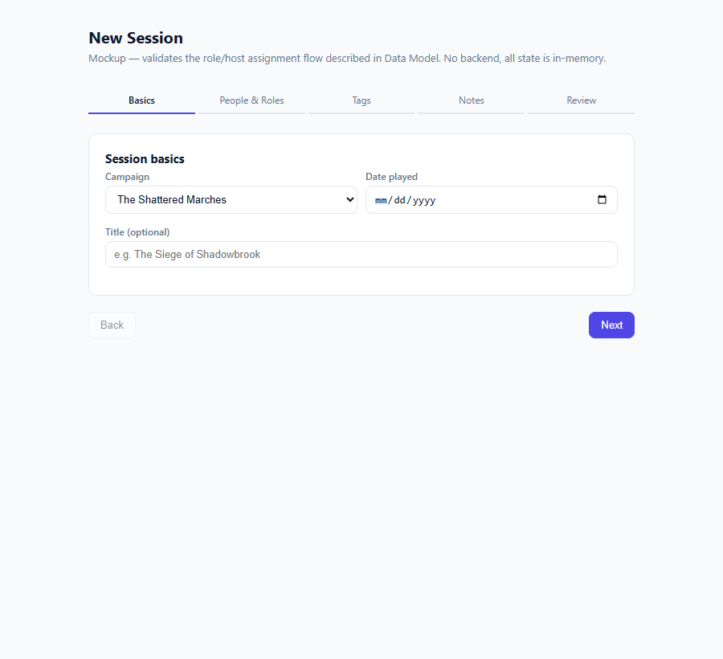
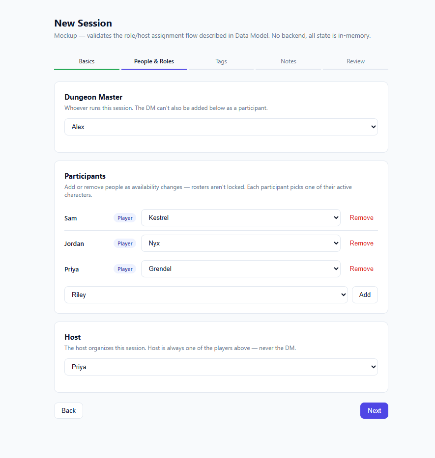
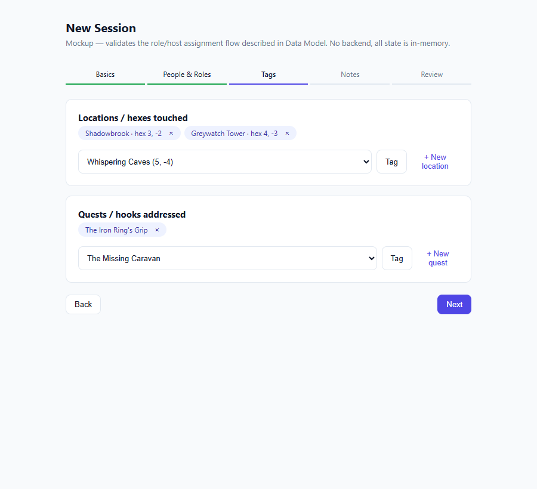
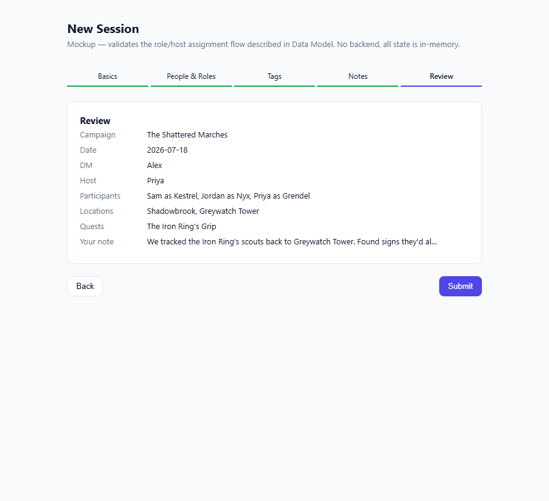

# UI Mockups

Static, self-contained HTML/CSS/JS prototypes used to pressure-test a flow
before it becomes real frontend code. No backend, no build step, no
frameworks — just enough interactivity to click through the actual
decisions a screen has to make. Styled to approximate the
[React + shadcn/ui + Tailwind](../roadmap.md#constraints-this-plan-works-within)
stack chosen for the real app, so the look is roughly representative, not
just illustrative.

## Session entry — role & host assignment

**[Open the interactive mockup →](session-entry.html)**

Validates the trickiest part of the flow described in
[Data Model → Session entry journey](../data-model.md#session-entry-journey-the-core-recurring-flow):
a person has exactly one role per session (DM or player), and the host is
always one of the players — never the DM. The mockup enforces this
structurally rather than with a validation error: the DM picker and the
participant-add picker draw from mutually exclusive pools, and the host
picker's options are built only from the current participant list, so
there's no state in which the DM could even be selected as host.

**1. Basics** — campaign, date, optional title.

**2. People & roles** — assign the DM, build the participant roster
(add/remove freely, pick each person's active character — note Priya has
two active PCs to choose from), then assign host from the participant list.

**3. Tags** — tag locations/hexes and quests/hooks from the existing
registry, with inline quick-create for a location that doesn't exist yet
(Greywatch Tower).

**4. Review** — summary before submit; everything here was captured
through direct selection, no inference involved.

### What this validated

- The DM/host mutual-exclusion rule reads naturally as a UI constraint
  (two non-overlapping pickers) rather than needing an explicit error
  message after the fact — a good sign the underlying data model
  ([Data Model → Integrity rules](../data-model.md#integrity-rules)) maps
  cleanly onto how someone would actually fill this out.
- Multiple simultaneously-active characters per person (Priya: Grendel and
  Sable) didn't need any special handling — just a per-participant
  character picker scoped to that person's active characters.
- Inline quick-create for a new location mid-flow feels natural as a small
  expanding form rather than a separate modal/page — worth carrying that
  pattern into the real implementation.
