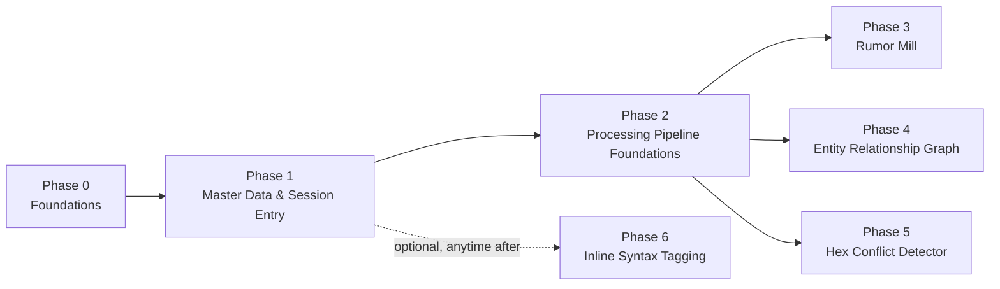

# Roadmap

This is the phased build plan for the features described on the
[Home](index.md) page. [Data Model](data-model.md) covers the entity design
behind it, and [Architecture](architecture.md) covers the surrounding
technical machinery. **Status: not started** — this page is the plan of
attack for a future implementation session; nothing described here has
been built yet.

## Constraints this plan works within

- Local development, with local deployment also supported (the app itself
  runs via `docker-compose`, not just its infra dependencies).
- Cloud is AWS-only, and only "eventually" — no cloud-specific work now, but
  choices avoid anything that would be awkward to run on AWS later (e.g.
  RDS Postgres compatibility).
- Open-source only, zero subscription/infra cost during development.
- Ollama for the LLM now; the provider must be swappable later (see
  [LLM provider abstraction](architecture.md#llm-provider-abstraction)).
- Postgres is the default datastore for everything unless a feature has a
  genuinely better-fit alternative.
- Explicit goal: use this project to grow real-world technical skills — when
  a minimal-footprint option and an industry-standard option are a close
  call, prefer the industry-standard one. This is why the plan uses
  Celery + Redis for background jobs rather than a Postgres-only task queue,
  and Discord OAuth (a standard OAuth2 flow) for login.
- **Structure over inference**: master data (people, characters, entities,
  sessions, tags) is captured through direct references at entry time, not
  reconstructed from freeform text afterward. See
  [Data Model](data-model.md#structure-over-inference) for the reasoning.
  This is why the build order below starts with master data and entry UX,
  not with the AI pipeline.
- Multi-user from the start — DMs and players both log in (Discord OAuth)
  and enter their own notes. Editing is entitlement-based in design, fully
  open in practice for v1 (see
  [Authentication and entitlements](data-model.md#authentication-and-entitlements)).
- Audio/voice-note intake and note revision history are both explicitly
  **out of scope**.
- **Frontend stack: React + Vite + TypeScript** (client-rendered SPA
  against the FastAPI backend — no Next.js/SSR, since there's no need for
  it here). Chosen over Angular (which the user already knows, but not
  deeply) for the same reason as Celery + Redis: given a close call,
  prefer the option with more real-world transferability and a bigger
  stretch from what's already familiar. React also has the strongest
  ecosystem fit for what this app specifically needs — mature libraries for
  forms, data tables, markdown, and node/edge graph visualization
  (`react-flow`, for the later entity relationship graph view). Default
  supporting choices: **TanStack Query** (data fetching/caching),
  **React Hook Form + Zod** (forms/validation — Zod schemas mirroring the
  backend's Pydantic schemas), **shadcn/ui + Tailwind** (components), and
  **React Router**.

## Build order

Master data and the entry journey are prerequisites for everything else —
every AI feature operates on data captured through them, not on raw
uploaded text. The processing pipeline (queueing, provenance, the review
queue) is built once, generically, before any specific AI feature, since
all three later features are just different consumers of the same
`ProcessingRun` machinery.

Phases 3, 4, and 5 only depend on Phase 2's pipeline, not on each other —
their order is a build-order choice, not a hard technical dependency. Phase
6 (the Obsidian-style `[[wiki-link]]` tier) is genuinely secondary and can
slot in whenever, since plain-text notes work without it.

### Phase 0 — Foundations

Provider-swappable LLM factory (`app/agent/llm.py`), Celery + Redis wired
into `docker-compose.yml`, Alembic initialized, app `Dockerfile` plus
`api`/`worker`/`redis` compose services, Discord OAuth2 login (backend
callback + `Person` creation), and the entitlement policy seam
(`has_permission()`, stubbed to always allow).

This is also where the frontend app shell gets scaffolded — a bare React +
Vite + TypeScript app (routing, API client, TanStack Query set up) with the
Discord login flow wired end-to-end (redirect out, callback in, session
established), since auth is infrastructure every later screen depends on,
not a feature of any one of them. No actual data-entry screens yet — those
are Phase 1.

**New dependencies (backend):** `langchain-ollama`, `celery`, `redis`,
`alembic`, an OAuth2 client library for the Discord flow (e.g. `authlib`);
move `httpx` from the dev group to main.

**New frontend app (`frontend/`):** Vite + React + TypeScript, React
Router, TanStack Query, React Hook Form + Zod, shadcn/ui + Tailwind (see
[Frontend stack](#constraints-this-plan-works-within) above); its own
`Dockerfile` (static build served via nginx) and an `web` service in
`docker-compose.yml`.

**Verify:** `docker-compose up` brings up the full stack including the
frontend; a trivial Celery `ping` task round-trips through Redis;
`poetry run alembic upgrade head` runs clean; clicking "log in" in the
browser completes the Discord OAuth round trip and creates a `Person` row.

### Phase 1 — Master Data & Session Entry

The core deliverable of this phase is the entry journey itself (see
[Data Model](data-model.md#session-entry-journey-the-core-recurring-flow)),
not an AI pipeline:

- CRUD for `Campaign`, `Character`, and `Entity` (NPC/location/faction/item/
  quest), including inline quick-create from the session flow.
- `Session` creation/editing: assign DM, manage the participant roster
  (add/remove people freely — rosters change constantly), assign host
  (must be a `player`-role participant, never the DM), tag
  locations/hexes and quests via `SessionEntityLink`.
- `Note` creation/editing per participant — single markdown field, mutable,
  no revision history.

**New tables:** `Person` (created only via login), `Character`, `Entity`,
`Session`, `SessionParticipant`, `SessionEntityLink`, `Note`. Full column
detail in [Data Model](data-model.md#core-entities).

**Verify:** a host creates a session, assigns a DM and host (rejecting an
attempt to assign the DM as host), adds/removes participants, tags a
location and a quest (quick-creating the location inline), and each
participant adds and later edits their own note.

### Phase 2 — Processing Pipeline Foundations

Generic infrastructure the three AI features below all sit on top of —
built once, not per feature:

- `ProcessingRun` / `ProcessingRunInput` tables and the Celery task that
  executes a run against whatever notes are in scope.
- A `capture_method` / `review_status` convention applied consistently to
  every derived-fact table added in Phases 3–5.
- A review queue endpoint/screen listing `pending_review` facts for DM
  approval — generic across fact types, not built per feature.

No decision on processing *cadence* is made here (per-note, per-session, or
a periodic batch) — the schema and queue don't commit to one; whatever
triggers a run just constructs its `ProcessingRunInput` scope accordingly.

**Verify:** manually enqueue a run against a session's notes; confirm a
`ProcessingRun` row and its `ProcessingRunInput` rows are created;
confirm editing a note after the run makes it show up as stale (per
[Provenance and reprocessing](data-model.md#provenance-and-reprocessing)).

### Phase 3 — Automated Rumor Mill

A `generate_rumors` task consumes a `ProcessingRun`'s notes → structured
LLM output (`rumors: list[str]`, max 3) → persisted `rumors` rows
(`capture_method = llm_inferred`, `review_status = pending_review`) →
`httpx` POST to `DISCORD_WEBHOOK_URL` once approved.

**New table:** `rumors` (id, source_processing_run_id, campaign_id, text,
capture_method, review_status, pushed_to_discord, created_at).

**Verify:** run the pipeline against a session with notes, confirm 1–3
rumor rows land in the review queue, approve one, confirm it posts to a
test Discord webhook.

### Phase 4 — Entity Relationship Graph

An `extract_entities_relationships` task consumes a `ProcessingRun`'s notes
→ structured LLM output (relationship events, including "ends" events,
each tagged `capture_method = llm_inferred`) → lands in the review queue →
on approval, appended to `RelationshipEvent`. Add a `query_relationships`
agent tool (mirrors the existing `lookup_lore` tool pattern in
`app/agent/tools.py`) that resolves "current state" for a given entity or
location. Expose `GET /entities/{id}/relationships`.

**New table:** `RelationshipEvent` — see
[Data Model](data-model.md#core-entities) for the full column list.

**Verify:** run the pipeline across two sessions where the second event
ends a relationship asserted in the first (e.g. an NPC dies); after both
are approved, confirm the "current state" resolver excludes the ended edge.

### Phase 5 — Hex-Based Conflict Detector

Because locations/quests are already tagged on sessions via
`SessionEntityLink` (Phase 1), this phase is lighter than originally
scoped — no spatial inference step is needed. Add embedding generation
(`OllamaEmbeddings`, `nomic-embed-text`) into a new `lore_chunks` table on
processing. A pre-session planning view/endpoint takes a session's tagged
locations, computes a hex-radius candidate set in Python, runs a
`pgvector` similarity search scoped to those hexes, and returns an LLM
classifier's structured `{conflict: bool, explanation: str}` verdict.

**New table:** `lore_chunks` (id, source_processing_run_id, chunk_text,
embedding vector(768), hex_q, hex_r, campaign_id).

**Verify:** seed two sessions tagged to adjacent hexes with a real
contradiction (e.g. "collapsed the cave entrance" vs. a later session
tagged to the same location assuming access); confirm the pre-session view
flags it, and confirm a session tagged to a far hex is not flagged.

### Phase 6 — Inline Syntax Tagging (secondary, optional)

Obsidian-style `[[Entity Name]]` (and similar) markup inside `Note.content`,
parsed deterministically (no LLM call) at save time, `capture_method =
syntax`, auto-approved. Editor-side autocomplete against the `Entity`/
`Character` registry. This can be built any time after Phase 1 — nothing
else depends on it, and plain-text notes work fully without it.

## Files touched (once implementation begins)

Following the existing module boundaries in `app/`:

- `app/auth/` (new) — Discord OAuth2 flow, session/token handling,
  `has_permission()` entitlement seam
- `app/agent/llm.py` (new), `app/agent/graph.py` (refactor to use it),
  `app/agent/tools.py` (add `query_relationships`)
- `app/worker/celery_app.py`, `app/worker/tasks.py` (new package)
- `app/db/models.py` (new tables per [Data Model](data-model.md)),
  `app/db/session.py` (add a sync engine for the worker), `alembic/` (new)
- `app/api/routers/{sessions,entities,people,characters,review_queue,rumors}.py`
  (new — replaces the current two-endpoint `app/api/routes.py`)
- `app/schemas/campaign.py` → extended with per-feature schemas as they're added
- `frontend/` (new) — React + Vite + TypeScript app for the data-entry
  journeys; its own `Dockerfile` — not yet scaffolded
- `Dockerfile` (new), `docker-compose.yml` (add `redis`, `api`, `worker`, `web`)
- `pyproject.toml` (new dependencies)
