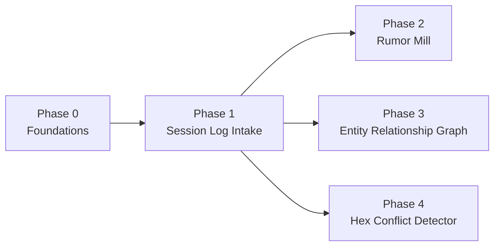

# Roadmap

This is the phased build plan for the four features described on the
[Home](index.md) page, and the cross-cutting decisions behind them are
detailed in [Architecture](architecture.md). **Status: not started** — this
page is the plan of attack for a future implementation session; nothing
described here has been built yet.

## Constraints this plan works within

- Local development, with local deployment also supported (the app itself
  runs via `docker-compose`, not just its infra dependencies).
- Cloud is AWS-only, and only "eventually" — no cloud-specific work now, but
  choices avoid anything that would be awkward to run on AWS later (e.g.
  RDS Postgres compatibility).
- Open-source only, zero subscription/infra cost during development.
- Ollama for the LLM now; the provider must be swappable later (see
  [LLM provider abstraction](architecture.md#llm-provider-abstraction)).
- Postgres is the default datastore for everything unless a feature has a
  genuinely better-fit alternative.
- Explicit goal: use this project to grow real-world technical skills — when
  a minimal-footprint option and an industry-standard option are a close
  call, prefer the industry-standard one. This is why the plan uses
  Celery + Redis for background jobs rather than a Postgres-only task queue.
- Audio/voice-note intake is explicitly **out of scope** — the session-log
  intake pipeline only needs to handle pasted text (bullet-point or
  narrative style).

## Build order

Session log intake is a prerequisite for the other three features — they
all consume its output. Among those three, the simplest pipeline
(Rumor Mill) is built first to validate the Celery/Redis plumbing before
the harder graph and spatial-vector work.

Phases 2, 3, and 4 only depend on Phase 1's output, not on each other — the
order between them is a build-order choice (simplest first), not a hard
technical dependency.

### Phase 0 — Foundations

Provider-swappable LLM factory (`app/agent/llm.py`), Celery + Redis wired
into `docker-compose.yml`, Alembic initialized (baseline migration =
current `campaigns`/`entities` tables), app `Dockerfile` plus `api`/
`worker`/`redis` compose services.

**New dependencies:** `langchain-ollama`, `celery`, `redis`, `alembic`;
move `httpx` from the dev group to main (needed for the Discord webhook in
Phase 2).

**Verify:** `docker-compose up` brings up the full stack; a trivial Celery
`ping` task round-trips through Redis; `poetry run alembic upgrade head`
runs clean against a fresh database.

### Phase 1 — Multi-DM Session Log Intake

`POST /session-logs` accepts pasted text in any style (bullet points or
narrative prose). A `normalize_log` LLM call formats it into a strict
Pydantic schema (date, players, location + hex coordinates, key
achievements, casualties, open plot hooks). `PATCH /session-logs/{id}/approve`
flips status from `draft` to `approved` — later phases hook this event.

**New table:** `session_logs` (id, campaign_id, raw_input, structured
JSONB, status, timestamps).

**Verify:** paste a messy bullet-point log and a narrative-style log through
`/session-logs`; confirm both normalize to the same structured shape.

### Phase 2 — Automated Rumor Mill

On log approval, enqueue a `generate_rumors` Celery task → structured LLM
output (`rumors: list[str]`, max 3) → persist to `rumors` → `httpx` POST to
`DISCORD_WEBHOOK_URL`.

**New table:** `rumors` (id, session_log_id, campaign_id, text,
pushed_to_discord, created_at).

**Verify:** approve a log, confirm 1–3 rumor rows are persisted, and (with a
test webhook URL configured) confirm a message lands in Discord.

### Phase 3 — Entity Relationship Graph

On log approval, enqueue an `extract_entities_relationships` task →
structured LLM output (entities + relationship events, including "ends"
events) → upsert `entities`, append to `relationship_events`. Add a
`query_relationships` agent tool (mirrors the existing `lookup_lore` tool
pattern in `app/agent/tools.py`) that resolves "current state" for a given
entity or location. Expose `GET /entities/{id}/relationships`.

**New table:** `relationship_events` (see
[Entity relationship graph](architecture.md#entity-relationship-graph-event-sourced)
in Architecture for the full column list and reasoning).

**Verify:** run two session logs where the second event ends a relationship
asserted in the first (e.g. an NPC dies); confirm the "current state"
resolver excludes the ended edge.

### Phase 4 — Hex-Based Conflict Detector

Add embedding generation (`OllamaEmbeddings`, `nomic-embed-text`) into a new
`lore_chunks` table on log approval. `POST /session-logs/draft-check` (a
DM's upcoming-session notes plus hex coordinates) computes a hex-radius
candidate set in Python, runs a `pgvector` similarity search scoped to
those hexes and the campaign, then an LLM classifier returns a structured
`{conflict: bool, explanation: str}` verdict.

**New table:** `lore_chunks` (id, session_log_id, chunk_text, embedding
vector(768), hex_q, hex_r, campaign_id). Also adds `hex_q`/`hex_r` columns
to the existing `entities` table.

**Verify:** seed two logs in adjacent hexes with a real contradiction (e.g.
"collapsed the cave entrance" vs. a later draft assuming access); confirm
the draft-check flags it, and confirm an unrelated draft in a far hex is
not flagged.

## Files touched (once implementation begins)

Following the existing module boundaries in `app/`:

- `app/agent/llm.py` (new), `app/agent/graph.py` (refactor to use it),
  `app/agent/tools.py` (add `query_relationships`)
- `app/worker/celery_app.py`, `app/worker/tasks.py` (new package)
- `app/db/models.py` (new tables), `app/db/session.py` (add a sync engine
  for the worker), `alembic/` (new)
- `app/api/routes.py` → split into `app/api/routers/{session_logs,entities,rumors}.py`
  once it grows past the current two endpoints
- `app/schemas/campaign.py` → extended with per-feature schemas as they're added
- `Dockerfile` (new), `docker-compose.yml` (add `redis`, `api`, `worker`)
- `pyproject.toml` (new dependencies)
